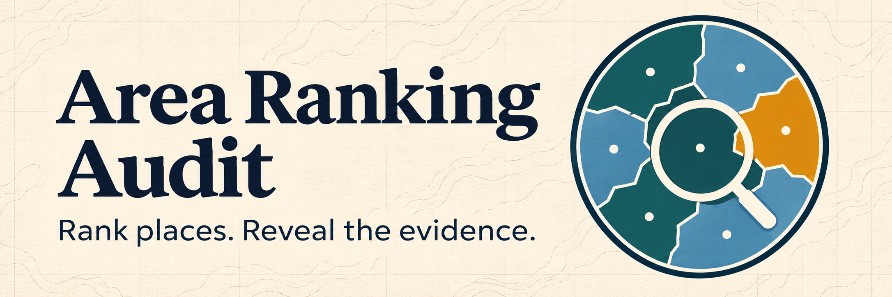

# Area Ranking Audit for ArcGIS Pro

[中文说明](README.zh-CN.md)

**Eligibility**: A region enters the ranking only when the shares of all planned points with complete measurements and meeting hard constraints both pass the chosen thresholds.

**Make every recommendation show its evidence: how many samples support the score, and who drops out when assumptions change.**

Area Ranking Audit helps analysts build candidate-level indicators and review regional rankings alongside the evidence behind them. It grew out of the GE5219 residential accessibility project, but accepts user-defined indicators and regions. This is an analytical workflow, not a new ranking algorithm.

## What it does

1. **Build Indicators** assigns planned candidate points to regions, measures facility counts within a radius or straight-line distance to the nearest feature, and joins existing numeric measurements by candidate ID. Numeric fields can be selected or imported in bulk. The resulting CSV is added to the current map as a standalone table when available.
2. **Audit Area Rankings** applies direction, weights and optional minimum/maximum constraints, checks region-level eligibility, and ranks eligible regions. It produces a report, tables and, when boundaries are supplied, a styled ranked-region layer. An optional candidate layer displays the status of each point.

All planned points remain in the regional denominator. Coverage means the fraction of points with **all** required indicators measured at the same point. The default settings require at least 90% complete and 50% feasible planned points; fewer than three feasible points triggers a low-sample flag. These are adjustable project assumptions, not universal standards.

Reference values use each indicator's 5th and 95th percentiles. Save and reuse the reference when comparing weights or subsets. Optional one-at-a-time and Monte Carlo weight sensitivity report changes under stated assumptions; simulated top-K frequency is not a probability that an area is suitable. Alternative sampling or zoning can be compared using common point IDs.

## Requirements and installation

- ArcGIS Pro with ArcPy and an appropriate Esri license. Local testing used **ArcGIS Pro 3.5.1**; a second-machine test has not yet been completed.
- To use the standalone package, download [Area_Ranking_Audit.gpkx](dist/Area_Ranking_Audit.gpkx). In Pro, use **Extract Package**, then add the extracted `p30/adapter/AreaRankingAuditRelease.pyt` toolbox through Catalog.
- To use the editable source, download this repository and add `adapter/AreaRankingAudit_UI.pyt` through Catalog → Toolboxes → Add Toolbox. Keep the `adapter`, `build`, and `core` directories together. The legacy toolbox beside the UI toolbox is a runtime dependency.

The package contains a synthetic dataset. For the editable source, the synthetic CSV and GeoJSON files are in `examples/`; import or convert them to suitable Pro feature classes before using spatial tools. The package's extracted `commondata/synthetic.gdb` contains ready-to-use `candidates`, `regions`, and `measurements` feature classes/tables.

## Quick start: synthetic example

1. Run **Build Indicators**. Select the package's `candidates` points and `regions` polygons; choose `point_id` and `region` as IDs. Under existing measurements, choose `measurements`, match on `point_id`, and select `indicator_1` and `indicator_2`. Save the output CSV to a new writable filename.
2. Run **Audit Area Rankings** on that CSV. Choose `point_id` as candidate ID and `region` as region ID. Set both indicators to **Higher is better**, weight **0.5** each, and leave Minimum and Maximum blank. Under normalization reference choose **Use separate reference CSV** and select the package's `reference_sample.csv`. Choose a writable output parent folder.
3. To create a map, choose `regions` under Region polygons and `region` as its ID; optionally choose `candidates` and `point_id` for the point map. Run the tool and open `Ranked regions.lyrx` from the output folder if it is not automatically added.

Expected top five: **A, C, D, E, F**. A ranks first but has only one point and is flagged as low sample. B has two indicators each present for 9 of 10 planned points, but the missing points differ: joint completeness is 8/10, below the 90% threshold. See [the worked example](examples/README_统一考题.md).

## Outputs and interpretation

The output folder includes an HTML report, candidate and area CSV tables, the run configuration and saved reference JSON. Supplying polygons creates `results.gdb/ranked_regions` and `Ranked regions.lyrx`; providing candidate points can also create `audited_points` and its layer. A region's score is the mean over feasible points; eligibility, number of points and coverage should be read alongside the score. Ineligible or unmeasured areas must not be treated as low-scoring eligible areas.

## Scope and limitations

- Counts and straight-line distances depend on input data coverage, geometry and an appropriate projected coordinate system. Straight-line proximity is not a walking-network travel time.
- This toolbox does not calculate driving routes or geocode school addresses. Import externally calculated route measurements as numeric fields, preserving missing routes as missing values.
- Fixed reference values support comparisons; changing measurement definitions, reference population, hard constraints or sampling design can change results. Sensitivity analysis does not establish conceptual validity.
- Open-source code does not include or grant an ArcGIS Pro license. Real GE5219 source data are not included; the example data are synthetic.

## Repository layout

- `adapter/`: interactive and legacy Python toolboxes.
- `build/`: indicator construction code and tests.
- `core/`: ranking, eligibility, and sensitivity calculations.
- `examples/`: synthetic data and the worked answer.
- `dist/`: ArcGIS geoprocessing package.

## License and acknowledgements

Code and synthetic examples are available under the [MIT License](LICENSE). The tool was developed from work on the GE5219 group project. ArcGIS and ArcGIS Pro are Esri products and are subject to their own terms.
